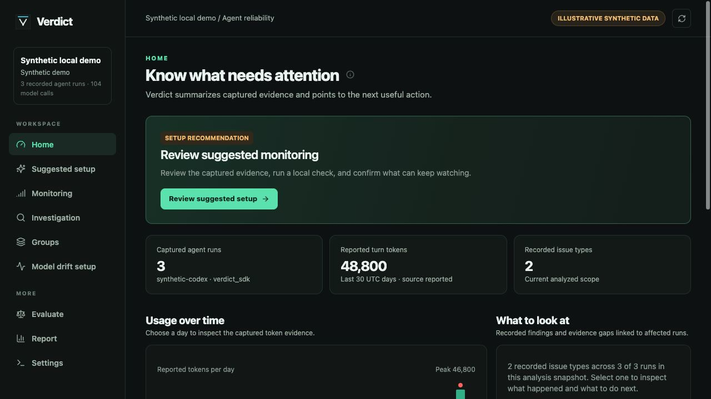

# Verdict

[](https://github.com/cognifityai/verdict/actions/workflows/test.yml) [](https://pypi.org/project/cognifity-verdict/) [](LICENSE)

**Monitoring and investigation for AI agents in real applications.**

Verdict connects an agent's runs, turns, tools, tests, and application-reported outcomes to the model calls made along the way. It helps answer what happened, where time and tokens went, which failures need attention, and whether measured behavior changed. The dashboard brings capture, investigation, evaluation, comparison, and monitoring into one workflow.

Verdict is local-first. A Python application can write to SQLite or PostgreSQL, or spool bounded records for a separate local service to import. Claude Code and Codex history imports are additional ways to explore agent activity; they are not the scope of the product.

The current beta includes guided Home and setup, worker status, source and agent groups, and optional explanations of selected evidence. The same workflows are available from the released packages and this source checkout.



*Home in a synthetic local demo; counts and findings are illustrative.*

## What you can do

| Workflow | Evidence and result |
| --- | --- |
| **Observe an application agent** | Record runs, turns, tool calls and results, tests, feedback, and explicit business outcomes. Supported Anthropic, OpenAI, and Google SDK calls add genuine model-call traces with provider-reported usage, latency, finish reason, and errors where available. |
| **Investigate an issue** | Start from Home's recorded issues or usage evidence, open the affected session or run, and inspect the linked event, timeline, and suggested next check. The report summarizes application and model-call activity with coverage shown. |
| **Evaluate and test a change** | Run deterministic checks on recorded evidence. Preview a bounded session, run, turn, tool action, or model call before an optional judge evaluation. Save reviewed cases and compare a configured application baseline and candidate against the same checks. |
| **Monitor ongoing activity** | Schedule deterministic analysis of captured agent activity. Separately, review and activate a prospective statistical monitor for genuine provider model calls, with sample and evaluator gates; configure notifications if needed. |

The [Agent Profiler guide](docs/AGENT_PROFILER.md) explains the investigation workflow and its evidence limits. The [onboarding guide](docs/ONBOARDING.md) covers capture, imports, evaluation, and monitor setup.

## Choose how to use Verdict

| Your starting point | Start here | What Verdict records |
| --- | --- | --- |
| A Python agent or application you operate | [Instrument an application agent](#instrument-an-application-agent) | Application-reported runs, turns, tools, tests, and outcomes; supported provider SDK calls link model traces to that work. |
| A customer-managed deployment | [Production deployment](#production-deployment) | The same evidence in a dedicated PostgreSQL store, with separately run dashboard and monitoring worker. Producers can write directly or send local spool files through a shipper and collector. |
| Local Claude Code or Codex history | [Local history quickstart](#try-your-local-claude-code-or-codex-history) | Source-reported sessions, events, and usage where available; no application instrumentation required. |
| An existing conversation or telemetry export | [Import existing evidence](#bring-in-existing-evidence) | Supported LLM-call telemetry, or bounded text-only voice-conversation snapshots when the source provides them. |

## Try your local Claude Code or Codex history

On macOS or Linux with Python 3.12 (3.10 and 3.11 also work), start with the
dashboard package:

```bash
python3.12 -m venv .venv
.venv/bin/python -m pip install --pre 'cognifity-verdict[dashboard]'
.venv/bin/verdict
```

In the local setup page, choose **Claude Code / Codex**, check the detected
history directories, select **Preview sources**, then **Approve and capture**.
The background job attempts every discovered file once and shows file progress;
files it cannot safely parse are reported separately. The same approved roots
can be rescanned after a source changes or an interrupted job.
For a history file above 128 MiB and at most 1 GiB, Verdict captures a
bounded prefix and labels the source coverage partial; later activity in that
file remains unobserved. Files above 1 GiB are skipped with an explicit
reason so source verification remains bounded.
Use **Cancel capture** to stop after the current file; already imported files
remain available, and previewing the roots again allows a safe rescan.
Verdict reads those files without replaying agent commands. After capture,
**Home** shows recorded usage and any issues; **Investigation → Agent runs** opens
individual sessions. To import newer history later, use **Settings → Data
Sources → Manage data sources**. This import and the key-free views need no
provider API key. See the [local-history guide](docs/ONBOARDING.md#3-import-local-claude-code-or-codex-history)
for coverage, privacy choices, and optional evaluation.

## Instrument an application agent

With Python 3.10-3.12, install the current beta packages in an isolated environment:

```bash
python -m venv .venv
.venv/bin/python -m pip install --pre \
  'cognifity-verdict[anthropic,openai,google,dashboard]' \
  'cognifity-verdict-eval' \
  'cognifity-verdict-inspect'
```

For contributor development, install the packages in editable mode using [Contributing](CONTRIBUTING.md#development-setup).

Call `verdict.init()` once at application startup, then record the work your application can actually observe:

```python
import verdict

verdict.init(storage="sqlite:///./verdict.db", service_name="support-agent")

with verdict.agent_run(name="support-agent", session_id="session-123") as run:
    with run.turn(user_input="Look up the order") as turn:
        with turn.tool("lookup_order", arguments={"order_id": "sample"}) as tool:
            tool.set_output({"found": True})
        turn.set_output("The sample order was found.")
    run.record_business_outcome("resolved", True)
```

Run your supported provider SDK calls inside the turn to link their captured model traces to the agent work. Install the corresponding provider extra when the SDK is not already available, and check the [supported entry points](docs/RELEASE_PROFILE.md#2-use-a-released-provider-entry-point). Verdict records the outcome you supply; it does not infer task success from the final answer. See [agent instrumentation](docs/ONBOARDING.md#3a-instrument-the-surrounding-agent-execution) for test, command, retry, and feedback events, and for storage and file transport options.

For an existing Python application, the [integration assistant guide](docs/AGENT_SKILL.md) helps identify supported calls and choose a capture boundary.

Start the local dashboard against the same store:

```bash
.venv/bin/verdict-dashboard --storage sqlite:///./verdict.db --host 127.0.0.1
```

Open **Home** for a source-aware next step, recorded issues, and token usage. **Suggested setup** previews local checks; **Monitoring** shows worker and issue status; **Investigation** opens linked run and event evidence; **Groups** starts with recorded source and agent names, bounded read-only execution-status and tool-outcome previews, then provider and model fields with recorded provider-error counts and token coverage; **Model drift setup** previews genuine provider-call cohorts. The execution preview distinguishes finalized statuses from runs without a recorded end or terminal status. The separate tool-outcome preview distinguishes explicit failures, observed runs without recorded failure, and unclear or partially captured outcomes. For a complete bounded terminal-run sample, it also shows earlier/newer counts within each recorded agent group; these previews are not statistical alerts or proof of task success. A placeholder model marker is labeled as such rather than presented as a provider model. **Evaluate** and **Report** remain available in the sidebar. No provider key is needed to capture and analyze local evidence. A [fully synthetic demo](docs/AGENT_PROFILER.md#synthetic-local-demo) exercises that path.

## Production deployment

The customer-managed, single-tenant path uses a dedicated PostgreSQL database.
Install `cognifity-verdict[postgres]` in the dashboard, worker, and collector environments;
install the provider extras used by each instrumented Python application. The
dashboard, worker, and collector use the same storage URL and tenant ID. A
direct-store producer passes those values to `verdict.init(...)` and writes to
PostgreSQL. Alternatively, set `transport="file"` with a per-process spool directory, then run
`verdict-shipper` on the producer host and an authenticated central
`verdict-collector`. This path can ingest Agent evidence,
provider Traces, and manual Spans. Keep the collector behind TLS termination.

Run `verdict-dashboard` and a separately supervised `verdict-service` worker
against the same store. A saved monitoring plan does not start the worker;
confirm a completed cycle in **Monitoring** or the authenticated readiness API.
The [customer-managed operations guide](docs/CUSTOMER_MANAGED_OPERATIONS.md)
has the process commands, container profile, access controls, backup procedure,
and deployment checks. The [onboarding transport section](docs/ONBOARDING.md#3a-instrument-the-surrounding-agent-execution)
covers spool, manual import, shipper, and collector setup. Validate TLS,
networking, supervisor recovery, and expected load in your own environment
before relying on this deployment for production monitoring.

## Monitor behavior over time

Verdict has two monitoring paths:

1. **Agent activity:** Home and Monitoring link recorded issues to affected runs and events. Suggested setup proposes checks that fit the captured sources. Run a local check once, review its result, and then save a recurring plan. A separately supervised `verdict-service` worker must run future cycles; Monitoring shows its heartbeat and actual cycle outcome. Saved historical findings and notices from post-activation activity are labeled separately.
2. **Model-call changes:** Preview reference and current cohorts of eligible completed provider calls, review sample readiness, and activate a prospective policy for new traffic. Verdict judge and paired-replay calls are excluded. Provider errors and selected response signals can be checked without a judge; calibrated judge dimensions are optional. Statistical alerts apply to genuine model-call traces, while agent-session comparisons remain descriptive. See [how statistical monitoring works](docs/STATS_PRIMER.md).

A selected day, session, run, turn, tool event, model call, or supported span can request an optional AI explanation. Verdict previews bounded redacted evidence, destination, and a static price estimate before an approved provider call. AI can also draft setup suggestions, but the user reviews the plan and Verdict validates its eligibility before activation. See [monitor setup](docs/ONBOARDING.md#7-see-findings-evaluate-deliberately-and-configure-monitoring) for scheduling, notices, delivery, and approval details.

## Bring in existing evidence

- **Claude Code and Codex:** Preview and approve local history paths in **Settings > Data Sources**. The import is read-only against source files and does not replay commands. These histories can show sessions, turns, tools, and source-reported usage, but coverage differs from directly captured application agents and genuine provider calls.
- **Other telemetry:** `verdict-import --help` lists supported local and hosted sources. Imported model-call traces remain distinct from native agent turns. See [telemetry import](docs/ONBOARDING.md#4-import-telemetry-you-already-collect).
- **Conversations:** `agent_run(..., session_id=...)` groups an instrumented application's turns into an agent session. Separately, the text-only voice export importer can store a bounded, redacted conversation snapshot alongside eligible reply traces. Evaluator Lab can grade eligible snapshots; Monitor can show descriptive historical comparisons of those grades. These are not prospective conversation alerts, and generic application conversations are not automatically reconstructed from model calls. See [voice import and conversation assessment](docs/ONBOARDING.md#4-import-telemetry-you-already-collect) and the [source format](examples/telemetry/README.md).

## Evidence and privacy boundaries

- Token counts use the source's reported semantics; missing usage stays unknown. Cache and reasoning components are not added twice. Cost is a static API list-price estimate only when an attributable model and valid usage support it, not a subscription bill. Session elapsed time includes tools and idle time; captured model calls have separate latency.
- Suggestions point to recorded evidence and are prompts to investigate, not proof of waste or guaranteed savings. Fixed-case comparisons test the checks you define; neither a fluent answer nor a judge opinion establishes an application outcome on its own.
- Content is bounded and recursively redacted by default, but pattern-based redaction is not a compliance guarantee. Set `capture_content=False` for metadata-only SDK capture; content-dependent evaluation is then unavailable. Dashboard scoped judge calls require an explicit evidence preview and approval. Provider keys stay in environment variables.
- The dashboard binds to loopback by default. Non-loopback use requires credentials and an allowed-host configuration; see [deployment guidance](docs/RELEASE_PROFILE.md#6-pilot-acceptance-check).

## Development and release details

For supported provider methods, upgrade checks, and deployment boundaries, use the [release profile](docs/RELEASE_PROFILE.md).

Documentation by task: [local agent investigation](docs/AGENT_PROFILER.md),
[application capture and imports](docs/ONBOARDING.md),
[customer-managed operations](docs/CUSTOMER_MANAGED_OPERATIONS.md),
[evaluation](packages/verdict_eval/README.md),
[Inspect for conversation exports](packages/verdict_inspect/README.md), and
[statistical monitoring](docs/STATS_PRIMER.md).

Contributors can run the Python and UI checks and the synthetic smoke path from this checkout:

```bash
python -m pytest -q
pnpm --dir ui test
pnpm --dir ui build
python scripts/smoke_test.py
```

See [contributing](CONTRIBUTING.md), [architecture decisions](docs/adrs/), and [evaluation documentation](packages/verdict_eval/README.md). Apache 2.0.
