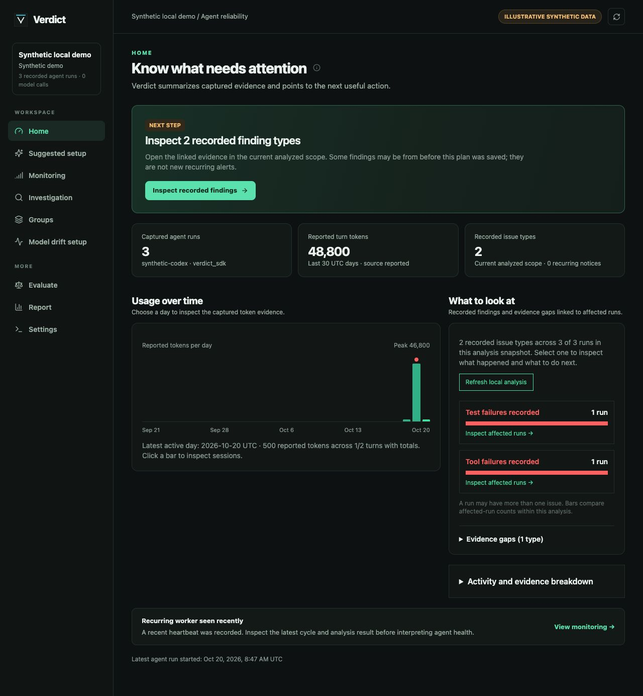

# Agent Profiler: local workflow and evidence contracts

This guide describes the guided workflow in the current beta. It is available from the published packages and an editable source checkout.

Verdict combines source-reported usage, typed agent actions, optional selected-scope evaluation, and fixed-case experiments. The same run report accepts imported Claude Code/Codex histories and application agents recorded through `verdict.agent_run(...)`. Capability differences come from the source evidence: Claude messages with an explicit provider response boundary can create linked model-call `Trace` records, and Codex completion diagnostics can create metadata-only model-call traces. Other turns may have no trace. Provider auto-instrumentation does not automatically provide application task outcomes.

Local-history discovery includes `.jsonl` files and Codex `.jsonl.zst`
archives in preview, capture, and rescan counts. Matching active `.jsonl` files
take precedence over their same-stem archives. Archives are read by streaming
decompression, with the decoded prefix and physical archive limits reported
separately.
The active file and its later archive retain one source identity only if the
decoded archive preserves the previously captured file bytes. Archive content
outside the parsed prefix is not normalized. Investigation offers up to 50
redacted newest source-record previews for inspection only. The sample may
overlap the canonical prefix and adds nothing to totals, monitoring, or
evaluation. Its preview text is sanitized before storage; a complete final
record is included even without a trailing newline. The newest sample is unavailable if an
archive expands beyond 512 MiB. A completed archive with an
unfinished final JSONL record is skipped; active `.jsonl` files can retain
complete records before an unfinished final line.

Run timelines, Insights link counts, and the V1 dependent-package read model expose a model-call Trace link only when the referenced Trace exists in the same tenant. Historical tenantless Traces remain visible to the local tenant. A missing or foreign Trace link remains in stored evidence for repair but is shown as unlinked; it cannot pull in that Trace's Judgment.

## Synthetic local demo

From an editable checkout with the Verdict and eval packages installed:

```bash
.venv/bin/python examples/agent_profiler_demo.py --database /tmp/verdict-profiler-demo.db
VERDICT_EXPERIMENT_RUNNER=verdict.dashboard.demo_task:run \
VERDICT_EXPERIMENT_CONFIGS='{"baseline":{"version":"baseline-v1"},"candidate":{"version":"candidate-v1"}}' \
.venv/bin/verdict-dashboard --storage sqlite:////tmp/verdict-profiler-demo.db --host 127.0.0.1 --port 8000 --synthetic-demo
```

Choose a fresh database filename; the generator refuses to overwrite a file. Open `http://127.0.0.1:8000/dashboard`. The explicit `--synthetic-demo` option labels the connected store as illustrative; omit it for a store that contains real activity. Without the option, the header says **Connected store** rather than asserting that the data is live. A synthetic source label in one record does not classify an entire mixed store. The sample contains a wholly synthetic three-turn coding session across two runs with reported input/output/cache counters and a recorded failed test, plus an application-agent run produced through the SDK. No provider key or network call is required. The **Evaluate → Saved Cases** sample routes a critical incident and a routine edit. The baseline fails to page on the critical incident but handles the routine edit; the candidate fixes paging but wrongly pages for the routine edit. Run this comparison explicitly. Its checks are deterministic and synthetic, not evidence of a live model improvement.

## Usage and run report



This screenshot was captured on 2026-10-20 from the source checkout's `examples/agent_profiler_demo.py` output, served locally with `--synthetic-demo` after running local analysis and one worker cycle. All records and numbers are illustrative; it is not a customer result or a claim that imported histories produce the same coverage.

Reliability shows recorded tool-call and reported tool-result counts beside the failure count. These are separate event-record counts and do not prove that every call has a matched result. Zero tool errors means zero among results that reported an outcome; inspect sparse result coverage before treating it as a healthy execution pattern.

**Groups** separately shows a bounded sample of recorded Agent Run execution statuses by exact source and agent identity. A missing end or terminal status is unfinalized. When every sampled run is unfinalized, Groups gives one coverage explanation, a Browse recorded runs action, and one exact example link instead of an empty outcome comparison. With terminal runs, the status view has exact run links. A truncation notice marks omitted older runs. This view describes capture coverage; it does not activate run-level drift monitoring.

The Reliability, Performance, and Behavior detail views disclose incomplete bounded Agent Run and Trace scans separately. Their totals describe the evidence scanned, not an unbounded whole-store guarantee.

A fresh analysis records the available Agent Run and Trace counts along with its bounded sample. When new evidence falls outside that sample, the result still updates its coverage and gets a distinct immutable identity; an unchanged rescan can reuse the current result.

Home shows the latest agent-run and model-call start times separately. It compares a tenant-scoped evidence revision with the revision verified by the saved analysis. A new or rewritten Agent Run or model call, including a same-count rewrite, requests a fresh local analysis before monitoring advice uses that snapshot. A no-change rescan can reuse the immutable analysis result and update only its verified revision. The latest terminal check remains visible after reload: a failed check is shown as failed until a later successful check, even if an older completed snapshot exists. Analyses saved before this revision marker was introduced require one fresh check. Earlier findings remain labeled as a snapshot. Report also separates scan completeness from freshness: a completed saved analysis can require refresh after evidence changes, and its HTML export carries the same label. The Home monitor-eligible count includes completed model calls and excludes judge and paired-replay traffic; the stored trace count remains visible separately. When agent turns lack reported token totals but model-call traces have them, Home shows a separately labeled daily model-call token chart and its call-count coverage. That fallback uses the selected Report period, while the agent-turn usage window remains 30 days; if the report has more active dates than the chart displays, the chart states the display cap. Its total sums only calls with both input and output totals; an incomplete call can still contribute to other recorded component metrics. The chart does not assign call tokens to sessions; selecting a UTC date opens that date's non-judge, non-replay calls in Investigation → Model calls, including calls whose token total is unavailable. The date filter is clearable.

In Investigation → Model calls, **No provider error recorded** means only that
the captured Trace has no error field. It does not establish a completed or
successful model response. Exact Trace IDs remain available for authenticated
drilldown even when the ID resembles sensitive text; captured prompt, response,
and error content remain redacted.

The current Reliability analysis partitions model calls into **Provider error
recorded**, **Ended without recorded provider error**, and **Unfinished**.
These states are based on stored error and end time; none establishes task or
model-response quality. A non-null error field counts as recorded even when
its text is empty. Refresh analysis after upgrading a source checkout:
older saved analysis used an inferred success label and is not reused by the
current analyzer. The management report uses the same three counts and no
inferred success rate. It excludes Verdict judge and paired-replay calls.
When the UI opens a published beta report payload, it marks both the
recorded-error count and completion as unavailable: that older format could
miss an error recorded as an empty string.

Response judging requires a finished model call with captured prompt and
response and no recorded provider error. A partial response on an unfinished
call may be inspected as evidence but is not planned for external judging;
finishing or correcting a call after preview requires a fresh preview before
execution. An imported voice assistant turn labeled completed still needs a
recorded end time before its legacy Trace projection is eligible for response
judging; the turn timestamp alone does not establish that end.

The current dashboard deterministic analyzer also checks whether recorded tool
calls have matching result IDs. Earlier saved analyzer rows remain stored, but
Home requires a fresh local analysis to include this coverage finding.
Investigation computes it from the selected run and links the affected call
or result records to a suggested source-capture check. It does not infer tool
or task failure. Recorded command exit codes and test failure counts must be
actual integers; malformed historical boolean values do not create failure
findings or recurring notices.

The Groups run-outcome preview treats malformed or non-object historical tool
attributes as unclear coverage instead of counting a completed result as clean.
An explicit failed or timed-out result status still counts as recorded failure.

For a Claude Code or Codex history beyond the canonical 1,500-event or
1,000-turn limit, Investigation retains the first 1,000 turns as a stable
historical prefix and can load a bounded recent window of up to 100 turns and
50 redacted events. The window labels its committed source revision, capture
time, source counts, and events outside the captured prefix and sample. It
recalculates deterministic findings for complete selected turns when read.
Bounded, fully parsed files within the local full-capture budget also retain
other non-prefix events and tail turns. In Investigation, **Browse recorded
events** pages them after verifying the committed revision, turn ownership,
and exact event count. This is complete recorded-event coverage for that
captured revision, not proof of task success. **Analyze recorded run** applies
the deterministic run checks to all retained typed events and turns only after
the same proof; each finding opens its first recorded evidence page. Where an
existing deterministic rule supports it, the report shows one suggested next
step with a link to its recorded evidence. The suggestion is not a verified
cause, recovery, or saving. The
ordinary run overview remains a bounded prefix view. A saved Insights analysis
uses the verified retained events and turns when the total expansion fits its
5,000 additional-row scan budget. A source that fails the proof or exceeds
that analysis budget remains partial in Insights, without a whole-run outcome
count. Recurring explicit-issue notices use the retained typed facts after
activation independently of that aggregate scan. When a saved Insights issue
opens a local run but its evidence lies outside the quick-view prefix,
Investigation automatically loads the current bounded sample and deterministic
recorded-run report. The selected issue can then open its exact retained event;
this navigation does not call an AI judge. The report appears before the recent
sample. Historical-prefix findings remain accessible in a collapsed disclosure,
and the run header identifies tool-call counts from that prefix. Selecting a
report finding or suggested action opens its supporting recorded event in view.
The on-demand Turn analysis API can inspect a
retained tail Turn only after the same complete-capture proof succeeds; it
still limits the events shown and does not infer unrecorded behavior.
Day token coverage can treat those retained tail Turns as complete only when
the same proof succeeds. The day issue reader scans retained typed events and
can report a complete recorded-issue total for that verified source when its
own bounded scan finishes. A source above the full-capture budget retains
only selected recent facts and keeps the issue total a lower bound. Retained
tail Turn tokens do not by themselves establish model attribution or price;
the usage report marks model evidence incomplete for that window.
Files above the budget retain selected non-prefix events as typed facts:
explicit recorded failures can create durable issue notices after monitoring
is activated, and linked model calls retain their Traces for supported
call-level evaluation. The current view supplies no whole-run issue denominator or no-alert claim,
or whole-turn judging for an incomplete turn. A zero finding count applies
only to complete selected turns. **Open exact event link** retains the event's
first-seen source revision and original turn/event IDs. That link resolves a
retained fact after the current window moves; while it remains selected, the
link opens the current event. The saved window holds bounded event references,
and the read path loads their retained details in one snapshot. For a retained
non-prefix event, the exact link must carry its first-seen digest; substituting
the current window digest does not prove that event's identity. An old window-only digest
may return `stale_revision`. Rescans reverify retained facts and linked Traces
against the parsed source before accepting a new revision.
The recent-sample response exposes a structural Trace link only when that
Trace is visible to the dashboard tenant in the same read snapshot, including
for older inspection-only windows and historical exact-event links. Validated
Trace IDs remain exact navigation keys; captured descriptive text is still
redacted independently.
An append-only rescan advances the prefix and window atomically. A larger rewritten source can
complete missing evidence only when the old and new histories are fully
captured and their retained facts remain compatible. A shortened or
conflicting source leaves the prior canonical run and dated window intact and
reports `local_source_conflict`; a failed window write rolls back the entire
capture. An unfinished
final JSONL line marks the current run and last parsed turn partial for
analysis, recommendations, turn review, and optional AI previews. The affected
last turn is withheld from Agent Turn judging, including a pending save, and an
older score is hidden until a successful rescan clears the partial status.
Earlier complete turns can still be selected. Saved analysis identity includes
the source revision, so a changed incomplete tail requires a fresh result.
Once an appended line completes, a successful rescan clears that transient
coverage. The recent window is shown only while its digest and counts match
the committed source checkpoint. The V1 whole-run read refuses a partial
historical prefix; earlier fully captured turns remain selectable. Token days
intersecting omitted source coverage are labeled partial, including days with
measured tokens from another source. The day comparison and optional AI day
preview withhold complete-total claims for those days.
Investigation labels the stored run status as a **recorded prefix outcome**
while source coverage is partial; it cannot establish the omitted tail's final
outcome. The token badge likewise labels its known prefix sum partial.
Insights excludes partial histories from whole-run outcome counts while
retaining observed prefix activity and event-backed findings with a
historical-prefix label. An incomplete final JSONL line or a file captured
only through the 128 MiB prefix (for files at most 1 GiB) makes the
unobserved tail's time range
uncertain for day totals; an earlier complete turn remains eligible for a
policy format check, while the affected final turn waits for a complete rescan.
The event capture-limit marker belongs to the first Turn with an omitted
event; a preceding fully captured Turn remains eligible. An Agent Turn at or
after that marker is excluded from native Turn judging; an older score on
that turn is hidden while the event
range is incomplete.

**Home** begins with one source-aware next step and captured evidence counts, then puts captured token usage and linked issues together. If Agent Turns have no reported token totals, Home links the latest recorded issue day directly to its bounded evidence instead of drawing a zero-token chart; Performance details retains the issue-event timeline. Worker status and latest capture times follow this evidence summary. If captured activity changes after the last analysis, the first step refreshes local findings; a stopped worker remains a separate setup action afterward. With no recurring plan, Home leads to reviewed setup even when the saved analysis contains historical failures; those counts alone are not new alerts. Select an issue in the adjacent panel to open an affected run with its finding, the linked event's captured fields and optional on-demand explanation, and any evidence-backed suggested action at the top. The issue metric shows current saved-analysis issue types unless an open recurring notice needs attention; zero recurring notices do not hide earlier recorded findings. When agent turns report totals, select a day and click **Explain this day** for the day-sliced total, largest sessions and turns, and a median of up to seven preceding active UTC days when the selected UTC day has ended, at least three prior active days and the selected day have complete turn-token totals, and the scan is complete. A day with missing turn totals, an incomplete final local-history line, or an older local import without a verified source checkpoint still shows its known sum and coverage, but receives no percentage comparison until the source is imported complete. A partial prior day also withholds that comparison. A pre-checkpoint Claude Code or Codex import makes event-time coverage of the whole displayed window unverified until a compatible rescan. A partial local-history import with omitted events makes issue counts lower bounds across the visible window because omitted event times cannot be bounded by Turn starts. An admitted complete projection can clear that uncertainty after its event proof and bounded scan. If all Turns and their token totals were captured, the event cap alone does not block token-day comparisons. Missing Turns can block comparisons on days intersecting the verified parsed Turn interval. An incomplete final line or an unverified checkpoint leaves the displayed window uncertain. The Home coverage notice distinguishes omitted older turns, incomplete model attribution, and incomplete or unverified local source history; one cause does not imply another. The token totals and local-source coverage for one report are read from one database snapshot; if the 30-day Turn scan is truncated, the comparison remains unavailable without a second unbounded source scan. Dates with neither captured turns nor recorded issue events remain labeled and are skipped in keyboard navigation only when no source-coverage gap affects them. A partial day with zero observed activity remains selectable so its uncertainty can be inspected; compact Home offers an **Inspect incomplete day** link when there is no captured token or issue activity to chart. A date with only a recorded issue remains selectable. The selected day shows deterministic tool, command, test, and explicit outcome issue events by event time, with links to example runs. This includes retained selected recent local-history facts outside the canonical prefix; those examples carry first-seen exact event links. When local source history is incomplete or unverified, a complete scan of stored events shows only an observed lower bound, not a full-day total; the linked examples remain available. An execution result explicitly reported as timed out is a recorded tool, command, or test issue even without a separate error count or flag, and counts as a reported outcome in the Reliability coverage figures. If that event scan is incomplete, no issue count is shown. A zero means no matching recorded event in the complete scan, not task success; late capture can update an earlier UTC date. The contribution list links to session and run evidence. When only provider calls report totals, the separately labeled chart opens that UTC date's call list; it does not assign those tokens to sessions. A session report can include turns from other days, so its full-window total is not used as the selected day's contribution. Issue types can overlap; their bars compare affected-run counts rather than parts of a whole. Missing totals stay unknown and can be inspected by session. When no recorded issue is found but the current analysis has evidence gaps, Home's summary counts those gap types, opens **Evidence gaps**, and makes inspecting them the next step before recurring setup; otherwise expand the panel to review missing or partial evidence. An active monitor alert appears in the status card; a saved schedule is labeled as unverified until a recurring worker heartbeat is seen. Historical comparisons remain in **Model drift setup**, separate from active alert decisions. Reliability, Performance, and Behavior detail views remain available through their existing deep links.

Recorded parent and child run links appear only when the run evidence contains an explicit parent ID. A missing or foreign-tenant parent is labeled unavailable; other captured agents on a run page without a recorded relationship are labeled unlinked. Timing and names do not establish a handoff. A selected run can also open the existing list filtered by both its recorded source and agent name, or by source when the agent name is absent; that filter helps inspect recurrence but does not establish the same task or cause. **Inspect session** opens and focuses the source-qualified session below the day explanation after it loads. **Investigation** leads a finding deep link with the failure, linked event, and next action; the full run browser remains expandable. Ordinary Investigation opens the run browser directly. The dashboard uses `GET /api/runs?view=list` for this bounded list; `selected_run_id` expands one run on the same page. The default `GET /api/runs` response retains its full run summaries for existing clients. A selected ID outside the page or tenant returns no selected run.

After a reviewed recurring plan is active, Monitoring also records a notice when a captured Agent Run explicitly ends `failed` or `timed_out` with a terminal timestamp. It opens that run without selecting an event. The status describes recorded execution, not task success, task failure, or drift. Event failure notices remain separate; one run can have both. Run-status notices cannot attach an event recheck.

The day explanation also offers **Preview AI context** and **Ask AI why**. This is one optional, explicitly approved interpretation, separate from PASS/FAIL scoped evaluation. The exact preview contains bounded aggregate metrics and numbered model, source, session, and turn contributors; it excludes chat text, tool output, raw model/source names, and local session IDs. It displays the destination and a conservative static list-price bound. Anthropic Haiku 4.5 and OpenAI GPT-4.1 mini are the supported choices. Optional AI use requires the Verdict eval package, the chosen provider SDK, and its API key in the dashboard environment; missing dependencies disable the call. The server binds approval to the current tenant, day evidence, provider, model, destination, and prompt version, records the attempt before egress, disables provider retries, and reopens a saved outcome without another call. A reserved attempt interrupted before saving its outcome stays unknown and is not retried. If new evidence arrives after preview, the user must preview again. The AI answer is an interpretation of recorded metrics, not verified waste, causality, or savings.

When token totals are captured, use the token chart on **Home** or open **Performance details** to select a UTC day and then a source/session. With only recorded issue events, Home links the latest issue day; Performance details shows the issue-event timeline. The chart shows reported input, output, cache, and total tokens where available, model attribution, estimated API list price, and coverage. Provider model-call aggregates are under **Model-call diagnostics**. Source-reported totals are authoritative where valid. Cache and reasoning subtotals are not summed into them again. Codex cumulative counters are converted to per-turn deltas only when source identity and ordering support that conversion. A missing total stays unknown at every level, even when known input and output components support a list-price estimate for one model and usage basis. If the 30-day model-event scan reaches its limit, fully scanned newer turns retain model attribution and price; the boundary turn and older turns are marked incomplete and left unpriced. Mixed, missing, or unrecognized models are left unpriced. A subscription charge cannot be inferred from this view.

The selected session report combines all runs sharing its source-qualified session identity, including requests and outcomes, usage coverage, event timeline, findings, suggested actions, and saved historical evaluations, which may reflect earlier evidence. A complete report covers up to 20 runs, 20 turns, and 80 events. Larger sessions show a bounded partial view with up to 20 turn excerpts, 80 event headers, and source-reported token totals for the displayed run slice; whole-session judging, findings, and list price are withheld. Open a linked run in **Investigation** for deeper evidence. A finding-selected run shows its linked event and matching suggestion before technical coverage; other findings and the full timeline remain expandable. Evidence references point to actual turns or events. Events with equal timestamps use run, producer, producer sequence (or local sequence), and event ID for stable display order; that order does not prove causality across producers. A failed tool or test suggests inspection, not proof that all subsequent work was wasted. The run's elapsed span is not model latency.

Suggestions currently flag a recorded tool failure or timeout, an unresolved recorded test failure, sustained reported input growth across turns with one token basis, and repeated large captured tool results. A positive recorded failure is shown before advice about call/result records that cannot be paired one-to-one. Missing, duplicate, invalid, or orphan IDs indicate unclear capture, not additional tool failures; the pairing advice links to the affected records. Input growth requires at least three nondecreasing reported inputs, with the last at least 10,000 tokens and twice the first. A repeated result must appear at least twice and contain at least 2,048 characters. These are review triggers, not measured waste: growing context may be useful, cached input may be cheaper, and repeated reads may be necessary. Each suggestion links to the observed turns or events and recommends checking a smaller alternative against the same task checks before changing a workflow. Verdict does not infer a failure's cause, which files consumed tokens, or a savings percentage from these rules.

A repeated identical tool-call finding reports the number of matching patterns, the configured call threshold, and the total linked calls. Its run view leads to those events and recommends reviewing whether retries or repeated reads were necessary before testing any workflow change. The finding alone does not establish wasted calls.

## Analyze and evaluate one scope

**Analyze turn** runs a local deterministic inspection. It requires no judge key and reports partial capture when the selected Turn or an earlier Turn in its run records a source capture limit; an empty later Turn is not treated as complete evidence. **Evaluate this turn** and **Evaluate this model call** on a selected genuine Trace route to Evaluator Lab with that exact selection. Changing the evaluation unit clears the selection and approval. **Evaluate this session** and **Evaluate this run** appear only when the selected scope passes the same evidence limits as its preview; otherwise the view shows the unavailability reason and a smaller evidence path. **Evaluate tool action** also produces an exact bounded redacted preview before an external judge call. The preview shows scope, criterion/rubric, model, resolved destination, evidence, coverage, one planned call, and a static price estimate when available. Approval is tied to its fingerprint; a changed criterion, destination, or evidence requires a new preview. No page load automatically invokes a judge.

After local-history capture, Settings → Data Sources reports how many imported
sessions hit the event-detail bound. The warning remains visible when that
capture switches to the connected-store view. It uses the newest local job with
an import summary, even if the later analysis failed. If a rescan fails before
producing a summary, the prior import summary remains visible.
This process-local warning is not an all-time count across every import and
does not survive a dashboard restart.

A session evaluation uses ordered evidence from every included run and requires at most 20 runs, 20 turns, 80 events, complete request/final-response evidence, and at most 8,000 redacted evidence characters. It is one evaluation of the whole session, not an average of turn grades. A run evaluation has the same turn, event, content, and character bounds for one run. An oversized or incomplete scope reports the first known unavailability reason with empty evidence text and no judge call. A tool-action evaluation requires the recorded task, usable tool contract/options text, explicit arguments (including valid empty arguments), and one unambiguous matching call/result pair. A source capture-limit marker on an earlier turn also withholds evaluation of later actions. An observed plan can be evaluated as a criterion; Verdict does not infer hidden planning. Missing, redacted, truncated, or ambiguous evidence is marked unavailable rather than scored as complete. An identical preview reopens its saved completed result or saved judge error without a new provider call. The scoped judge is asked to cite exact `[turn:...]` or `[event:...]` references. Fabricated turn/event references are rejected; other bracketed prose is ignored as a citation. An uncited grade is labeled an uncited judge opinion rather than an evidence-linked finding. Stored results include scope, evaluator and evidence fingerprints, coverage, criteria, verdicts, and evidence references. `PASS`, `FAIL`, `UNCLEAR`, judge error, and not-run are different states.

The UI's estimate is a static list-price estimate, not a billing cap. Provider SDK retry behavior can make actual billing higher. Eval Lab currently defaults Google to Gemini 3.5 Flash-Lite; provider availability and pricing can change, so review the resolved model and estimate before approval. The local demo does not run a paid provider. For live BYOK testing, configure the chosen provider key in the dashboard process, preview synthetic evidence, and approve the one call. Calibrate an evaluator against your own held-out labels before treating scores as reliable.

## Optional explanation and setup draft

A selected session, run, turn, tool event, genuine model call, or tenant-owned span offers **Explain with AI**. This is an interpretation, distinct from a graded evaluation. The server builds a bounded, recursively redacted preview tied to the selected tenant and evidence. Masked fields are omitted from this AI preview, including nested and serialized JSON values; independently recorded errors remain. If masking removes the selected failure's only recorded diagnostic, the preview withholds the call. Review its exact messages, destination, and static list-price estimate before approving one call. A repeated identical request reopens its saved outcome; an interrupted reserved call is not retried. Partial or oversized evidence produces no provider call. The panel explains unavailable evidence in plain language and hides approval controls when no call is possible. A source capture-limit marker on an earlier turn also withholds AI explanation of that turn and later turns or events; an earlier complete turn remains eligible. The model is asked to separate observed facts from interpretation and a suggested next check; it cannot establish hidden reasoning or verified savings. A span appears inside its call only when new capture recorded an explicit matching tenant identity. Existing ownerless spans remain stored but are not shown or sent to AI.

Redaction placeholders are missing evidence, not a diagnosis. A completed run
or turn records execution status, not task success or recovery; complete capture
coverage does not prove that all intended work ran. Review an AI explanation
against its linked event before treating a suggested cause as actionable.

**Suggested setup** and **Model drift setup** also offer an optional AI setup draft. They send aggregate eligibility only, with no chat or tool text. Model-call eligibility counts completed non-judge, non-replay traces, matching statistical monitor input. The returned check, grouping, and interval are constrained to supported choices. An agent-run draft can fill the local check interval; a model-call draft leads to a separate comparison preview. With at least 60 eligible calls, Model drift setup can also request a cohort draft from the aggregate count. Verdict rejects splits that cannot meet the proposed historical sample floors and restricts this draft to all eligible calls because aggregate evidence cannot establish per-model readiness. Applying it only fills local form controls; a fresh historical preview is required. Historical preview, sample gates, policy activation, schedule saving, and worker startup remain explicit. The deterministic suggestion and comparison work without an AI key.

When a model call or completed agent turn is selected in Evaluator Lab, an optional AI rubric draft can propose one observable criterion. It uses the selected bounded, redacted evidence and the same explicit preview, destination, price estimate, and one-call approval. Verdict validates the criterion name and description. Applying it appends an editable dimension to the local rubric and clears the previous evaluator preview; the user must preflight and approve any later evaluation separately. One example does not establish rubric accuracy, so calibrate against held-out labels before interpreting its grades.

In Groups, the read-only **Recorded tool-result coverage by run** card examines at most the latest 1,000 terminal runs and 10,000 relevant events (tool calls, tool results, and capture-limit markers) for the configured tenant. It shows explicit failed or timed-out tool results, runs with at least one completed result and no unclear evidence, unclear or partially captured outcomes, conflicting status/error flags, and exact run links. When tool calls are recorded, every call needs one matching result ID, with no orphan or duplicate result, before the run is counted as observed without recorded failure; a run with missing IDs or outcomes is unclear. Legacy result-only records retain their result-based label, which does not prove full action coverage. A recorded failure remains a positive signal even if later events were omitted; a completed result plus a capture-limit marker is unclear, not a clean run. Refresh run outcomes to include newly captured runs or retry a failed read. For a complete bounded sample, each recorded agent group shows earlier/newer counts of explicit failures, observed runs, and unclear runs in end-time order; the split has no alert decision or task-success claim. When older runs are omitted, the exact total is not counted, the split is withheld, and the card reports the sample size and truncation. A store that has not completed the writable Verdict storage upgrade cannot provide this indexed preview; the card shows no counts until it is upgraded. Unknown or unfinished imports do not enter the terminal sample. If the event limit is reached, no outcome counts are shown. The view reads no event content, makes no model call, and does not establish task success, an alert, or a monitoring policy. Provider/model cards separately show recorded call count, calls with a recorded provider error, and token-total coverage. Those counts are descriptive and do not establish task quality or drift. A `<synthetic>` model value is displayed as a synthetic marker, not as a provider model. A selected cluster from a reviewed registry version can request an optional label and description draft when it has at least ten assigned calls and two bounded representative prompts. The preview is tenant and version scoped. Applying the draft fills the existing rename field only; inspect representatives and members before choosing Rename cluster. The drafted description is advisory and is not stored as a cluster property. The AI suggestion does not establish semantic coherence or activate the registry.

## Saved cases and change comparison

**Evaluate → Saved Cases** accepts 1–10 reviewed cases with a runnable input, expected behavior, optional relevant context, and exact/contains/not-contains output checks. From **Investigation**, **Draft a reviewed case from this run** copies the first complete, already-redacted captured request into a new unsaved draft. If no complete request exists, the input remains blank. Review and edit the input for the configured runner, supply expected behavior and a check, and explicitly confirm review before saving. User-authored case fields are stored and passed to the configured local runner exactly as entered; remove secrets and private data before saving. Capture alone cannot establish the right answer. Verdict never executes commands copied from a Claude/Codex history automatically. Saving a case set creates a local versioned record. A serialized trial request over 16,384 bytes is reported as `input_too_large` without starting the runner. Experiment and scoped evaluation results are immutable records and cannot be rolled back through the control API.

The dashboard process must explicitly configure `VERDICT_EXPERIMENT_RUNNER` as `python.module:function` and `VERDICT_EXPERIMENT_CONFIGS` as a JSON object of named, versioned baseline/candidate configurations. The trusted function receives `(input, context, configuration)` and returns an output string or `{"output":"...", "usage":{...}, "costUsd":0.01, "costBasis":"provider_bill"}`. Each side uses the same saved cases and fixed checks. `VERDICT_EXPERIMENT_TRIAL_TIMEOUT_SECONDS` sets the host trial limit from 1 to 300 seconds (default 120); the effective value is displayed in the UI. The synchronous endpoint rejects a comparison before invoking the runner when cases × two sides × trials per side × configured trial timeout exceeds 600 seconds of runner time. Process cleanup and storage may add time; this is not a strict HTTP deadline. Use fewer cases/trials or a shorter host timeout to fit; one case with one trial per side can use the 300-second maximum. Output is bounded, and timeout stops the worker's ordinary POSIX process group before the next trial. This is process cleanup, not containment of deliberately detached processes or a security sandbox. Choose 1–3 trials per side. Saved comparisons can be reopened from recent history without rerunning the application. Verdict records configuration versions/fingerprint, case-set revision, evaluator identity, each trial's output, reported usage and cost if supplied, task elapsed time, errors, and fixed/regressed/unchanged/unverified groupings. It displays average runner elapsed time for verified trials and application-reported cost only when every trial on both sides uses one matching cost basis. Task elapsed time is wall time for the runner, not model latency. Application-reported cost is not independently verified by Verdict.

The runner is trusted host configuration, not user-submitted code. Run it against disposable or otherwise approved resources: Verdict cannot guarantee the runner itself has no side effects or that its initial state and external responses are equivalent. Checks test the specified output behavior only. Include cases that already pass to find collateral regressions, and repeat trials when nondeterminism affects the decision.

## Scheduled analysis

For older stored events with unreadable or non-object attributes, the notice scan uses the separately recorded execution status. An explicit failure or timeout still produces a notice; a completed status with unknown attributes does not. The notice scan continues to later events, but the deterministic analysis remains failed if it cannot decode the stored evidence; readiness reports that cycle failure.

The source checkout starts with linked evidence in **Home** and **Monitoring**. A saved deterministic analysis can show an actionable finding even before a recurring schedule exists; the Monitoring view labels its coverage and freshness, can refresh stale analysis locally without a model call, and opens affected runs. A run with an explicit failure but no richer recommendation gives a conservative, evidence-linked recheck, without claiming root cause or recovery. The suggested plan then reviews source directories and local checks, runs one cycle, and offers a recurring schedule. Monitoring also shows the latest check, next eligible worker check, and links to token usage, model-call comparison, and groups. After a tenant first activates its recurring schedule, each cycle records a content-free notice for an explicitly failed tool result, command, test, or business outcome event and for an Agent Run explicitly ending failed or timed out. Event-notice identity includes tenant, run, event, check code, and check version; run-status notice identity uses tenant, run, check code, and check version. Rescanning does not reopen a reviewed notice. Earlier imported history still appears in saved deterministic findings, but is not presented as a new recurring notice. The inbox opens the exact run or event and can prepare a local repair brief. Only an event notice can attach recheck evidence. An authorized operator may attach the exact run/event IDs of a later, explicitly positive result of the same event type. Verdict checks tenant, ordering, and result, then links both events; if either event later becomes unavailable or contradictory, the pass is withheld from the inbox. This records a later pass, not proof that the same work was retried, the cause was fixed, or the agent recovered. For SDK command and test events, an application may supply the same non-secret `check_id` on later attempts. Verdict stores its SHA-256 digest and the inbox labels a matching application-supplied check ID when both attached events carry it. Legacy, local-history, tool, and outcome events without this ID retain an unknown relationship. Matching IDs do not establish the same inputs, task, cause, or recovery. Acknowledging or dismissing a notice only records human review; a later failure creates its own notice. The inbox and its review states are independent of optional webhook or aggregate-finding delivery. An event deleted before any cycle cannot be recovered by this scan. `/api/control/issues` pages the tenant-scoped inbox; review transitions and recheck attachments require dashboard setup authorization.

For a command or test notice with a recorded check ID, **Find later matching checks** searches at most the first 200 later tenant event records and suggests up to ten explicit passes of the same event type and check ID. It never attaches a candidate automatically. A partial scan may omit another pass. Inspect a candidate, then use its IDs in the existing attachment form; that action rechecks current evidence. A matching ID does not prove the same inputs, task, cause, or repair.

When a notice has one or more valid attached later passes, Monitoring asks the operator to compare the failed event with the later evidence and verify which, if any, covers the same work. Without a pass, it suggests the relevant recheck. If an event appears in both the canonical record and a retained recent fact, Monitoring counts it once and uses the canonical record for its status and evidence link.
Opening either linked event in Investigation preserves the exact notice context and shows links to the failed evidence and currently valid attached passes. The run view reloads that one notice by tenant and does not call a later pass recovery.

**Model drift setup** shows the actual historical reference/current counts, the reference metric floor, the prospective target, and how many stored traces are excluded from monitor eligibility. The excluded count is store-wide; it is not the number outside the selected historical window. The review card identifies in-app Monitoring as the destination and links to the separate worker and delivery setup. After a model-call monitor is activated, its current bucket is prospective. Activation requires at least one reference metric in a group that meets the configured sample floor; a total count spread across sparse groups is insufficient. Activation saves a policy but does not start the worker or configure external delivery. The approved historical preview remains visible with a **Historical preview** label; its earlier no-alert result is not a decision about new traffic. Monitor reports collecting or awaiting evaluator evidence until a new comparison has actually run.

A manual or worker cycle with skipped local files, a failed recent index, or unavailable Codex diagnostics reports `capture_incomplete` as its latest outcome even if deterministic analysis completed. One approved capture attempts every discovered file once and reports progress after each attempt; a skipped file does not prevent later files from being attempted. Its returned capture summary gives counts and reasons. Previously stored runs remain last committed snapshots; the one latest-cycle code does not identify each source's freshness.

**Suggested setup** first runs the reviewed plan once, then allows it to be saved as an opt-in local schedule only when the selected checks completed. A saved schedule does not start the worker. The dashboard reports a recent `verdict-service` heartbeat separately from the saved plan and latest cycle result; stopping the worker removes that recent status. The header Refresh action reloads Monitoring's worker, cycle, issue, and saved-analysis state. A cycle that began without a recorded finish has unknown outcome, and an earlier success does not clear a later failure. A failed configured notification delivery is a failed cycle, including for model-call alerts. Manual checks are identified separately and do not establish that the recurring worker ran the current plan revision. The `/api/readiness` status endpoint uses the same configured dashboard Basic Auth gate as other tenant control endpoints. `verdict-service --storage sqlite:///./verdict.db --once` executes one configured cycle without a recurring heartbeat; without `--once`, it repeats at the saved interval. If the dashboard uses a custom `--tenant-id`, pass the same ID to the worker so it reads that tenant's plan and reports its heartbeat there. A schedule can rescan explicitly approved local history paths, or use **Analyze already captured agent activity** for SDK/incoming evidence with no local history path. Empty source fields are treated as absent in both saved and manual cycles. Each cycle runs persisted deterministic analysis. An existing prospective genuine model-call monitor may be advanced if explicitly selected. SQLite `~` paths expand to the process home, and relative paths resolve from its working directory; storage and the cycle lock use the same resolved file. Cross-process cycle locking prevents overlaps. The SQLite lock requires POSIX; on other platforms use PostgreSQL for scheduled cycles. The manual `POST /api/control/actions/run-schedule` uses the same cycle and returns a specific unsupported-platform error for non-POSIX SQLite. Notification delivery uses stored idempotency keys and requires an independently configured local log or HTTPS webhook destination. Configure the webhook at its final URL: redirects fail delivery, so Verdict never treats a redirected bodyless GET as a delivered alert.

A new suggested plan leaves Claude Code and Codex history paths blank even when previously captured runs carry those source labels. To import or rescan a directory during a check, enter its path explicitly; placeholders show common locations but are not submitted. A saved schedule keeps its reviewed paths.

Agent-session comparisons are descriptive and do not produce statistical drift alerts. The prospective model-call monitor keeps its minimum-sample, stable-evaluator, and multiple-testing rules; see [statistics](STATS_PRIMER.md). For a bounded session, run, or tool action, the preview also offers **Queue one evaluation** for Anthropic or OpenAI. Review the exact evidence, destination, criterion, and conservative static list-price bound, set a maximum approved static estimate, and explicitly authorize one later call. New guided plans set `includeApprovedEvaluations=false`, so manual and worker cycles leave pending approvals untouched. The advanced plan option can explicitly enable one pending approved job per cycle; that opt-in can send bounded evidence to the configured provider and incur cost. Previously saved schedules without this field retain their published behavior and may consume a pending approval until reviewed and changed. The manual cycle applies the same choice and rejects malformed values. A cycle chooses an approval whose provider key is available before leaving another pending approval waiting for its key. Only one approval for the same plan can be pending at a time. Each approval has its own identifier: after cancellation or a preflight failure before egress, a fresh review and confirmation can queue another. The service checks the SDK and judge identity before spending the approval. While another scoped evaluation holds the store lock, this approval remains pending; after the lock is available, the service rechecks evidence, destination, price bound, and judge identity before reservation. Once spent, the approval is never retried after an interrupted or timed-out attempt. A completed result or saved judge error is linked to the spent job and can be reopened without another provider call; an interrupted reserved attempt remains outcome unknown. An identical plan with a stored result reuses that result without another provider call, including when a fresh scheduled approval is consumed. Scoped calls against one store are serialized across dashboard processes, so a second simultaneous request rechecks the stored result after the first finishes. SQLite scoped evaluation requires POSIX for that lock; PostgreSQL uses its database lock. A crash after provider egress but before result storage can still leave an unknown outcome and a later direct request may make another paid call. Changed evidence cancels the approval before egress, and a pending approval can be cancelled in the same panel. Both Verdict and provider SDK retries are disabled for this path. The static estimate limit is not an invoice guarantee: provider pricing or billing can differ. Google and Jev are not supported for scheduled judging. Deterministic capture and analysis retry safely from stored evidence after an interrupted cycle; a consumed external approval does not.

The one-shot `verdict-service --once` command prints its completed cycle result as JSON and exits nonzero when that cycle records a failure, so an external scheduler can detect it. A busy cycle exits separately without claiming a run. It rejects a saved plan that was paused or revised after it was read and before the cycle lock was acquired; that rejection starts no capture or judge work.

The continuous worker polls for saved plan changes every 30 seconds. Pausing the plan keeps the worker available but prevents later cycles; a check already selected may finish. A resumed plan gets a new revision and is checked when the worker next polls. The due time is stored separately from the latest manual or worker cycle result, so a manual check cannot reset the worker cadence. Two workers share the existing cycle guard and recheck due state under it. A failed cycle waits for its configured interval; the worker logs its typed failure and continues polling. A process interruption after cycle start has a 30-second earliest retry. The dashboard labels the next worker eligibility time and requires a fresh local check before resuming.

## Privacy and support boundaries

Prompts, tool outputs, and judge replies are untrusted content. Verdict applies bounded, best-effort redaction before storage and before a scoped external preview. Review the exact preview before egress. Do not put credentials, customer traces, or private paths into saved case sets or screenshots. Explicit application-agent capture supports Python SDK contexts and existing documented transports; Claude Code/Codex are the first automatic local-history imports. No universal task correctness, automatic token savings, multi-agent causal attribution, or automatic connector support is implied.
